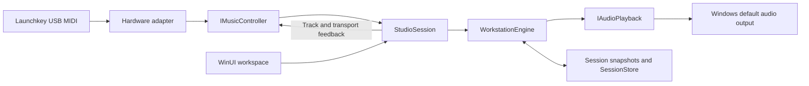

# Architecture

IgnitionSwitch owns sound generation, loop recording, playback, and project storage. No external DAW is required. Its first implementation targets the Launchkey 37 MK3 while keeping the musical model independent of a controller protocol or audio driver.

## Project boundaries

| Project | Responsibility | Dependencies |
| --- | --- | --- |
| `IgnitionSwitch.Core` | Musical snapshots, synthesis, sequencing, validation, and project persistence | .NET libraries only; no external packages |
| `IgnitionSwitch.Midi` | Hardware-neutral controller contracts, Windows MIDI ports, and the verified MK3 profile/codec | Windows MIDI APIs; references no UI or audio engine |
| `IgnitionSwitch.App` | WinUI workspace, session coordination, controller composition, and Windows audio playback | Core, Midi, Windows App SDK, NAudio WASAPI |

`Core/Domain` contains namesake records and the instrument enum. `Core/Audio` synthesizes voices, `Core/Sequencing` owns the engine, and `Core/Persistence` validates and stores snapshots. The public namespaces match those folders.

`Midi/Contracts` defines ordinary performance events, normalized music commands, identity, and feedback. Device-specific identities, port names, channel numbers, mode reports, and packet bytes belong in `Midi/Profiles`, `Midi/Protocol`, and `Midi/Devices`. `StudioSession` consumes commands such as track selection and transport changes. `ControllerFactory` is the application's current choice of adapter; session construction accepts another `IMusicController` without changing the engine.

## Playing and recording

`WorkstationEngine.Render` fills interleaved stereo floating-point samples at 48 kHz. Musical time advances from rendered audio frames. UI refresh timers display that state; they do not drive the sequencer. Scheduled loop events are ordered when recorded content changes. Live playing works while the transport is stopped or paused.

Play/pause preserves the transport position. Pausing ends recording, finalizes held recorded durations, and silences sequenced voices and the click while retaining live note/pedal ownership. Resume continues from that position; interrupted loop notes retrigger at their next scheduled onset rather than being reconstructed mid-note. Stop releases everything and rewinds. UI actions and normalized hardware transport commands use the same session behavior.

The initial project schema has four instrument tracks and a sixteen-beat loop. Recorded onsets and durations snap to quarter-beat steps: sixteenth notes in the current four-beat meter. Overdubbing the same pitch at the same grid point replaces that recorded note. Duration can cross the loop boundary. Track mutes/gains and master gain affect the shared mix, which is limited before output.

The engine serializes input, rendering, and state changes. Bounds on voices, recorded events, tempo, and file size keep the initial workload explicit. These are implementation limits, not latency guarantees; a physical audio timing pass remains required.

`AudioPlayback` implements `IAudioPlayback` using NAudio WASAPI shared-mode output on the Windows default playback device. `EngineSampleProvider` adapts the same engine used by tests to the audio callback. A valid output device is needed for audible playback and recording transport.

## Workspace presentation

The WinUI workspace centers transport, track controls, a four-lane loop view, and drum pads. `LoopTimeline` renders the beat/bar grid, recorded note geometry, track selection, and playhead. `InstrumentControls` constructs the track and drum controls. Hardware keys provide melodic performance. Device/audio details and shortcut help appear in flyouts when requested, keeping explanatory text outside the main working area.

Space invokes play/pause, R toggles recording, and Esc stops/rewinds. The stop shortcut remains available while a numeric control has focus. File pickers and confirmations are modal; the session also blocks new hardware notes and commands while continuing to process releases.

## Session ownership and persistence

`StudioSession` remembers the track that owns each incoming performance note, so changing selection does not send its release to another instrument. The conventional MIDI drum channel routes independently to the drum track. Sustain follows held/newly selected melodic tracks and releases all affected tracks on pedal-up. Supported controller actions are normalized before reaching this coordinator.

The session maintains a content revision and a saved revision. `CaptureForSave` returns a snapshot with its revision; a completed write marks only that revision saved. Changes after capture remain unsaved. Modal file and confirmation operations stop/finalize recording and block new hardware mutations while permitting note releases and pedal-up.

`SessionStore` shares its validation with `ApplySession` and `SaveAsync`. Projects are versioned JSON, limited to 4 MiB, and checked for supported track/loop counts, finite gains and tempo, bounded names, and valid MIDI events. Loading clones collections before applying them. Saving writes a temporary file beside the target, flushes it, then replaces the target.

Saved state includes tempo, loop size, master gain, track names/instruments/mutes/gains, and completed note events. Selection, the metronome toggle, and pitch/sustain automation are not persisted. Sustained notes are stored with their finalized durations.

Controller, audio, and engine lifecycles have separate owners. Session shutdown detaches controller handlers, ignores callbacks captured before disposal, closes hardware/audio resources, and then disposes the engine. Hardware feedback writes are serialized separately from input processing.

## Tests and tooling

All three check projects are dependency-free executable runners:

| Check project | Scope |
| --- | --- |
| `IgnitionSwitch.Core.Tests` | Actual rendered sample data, transport timing and pause/resume, note ownership/release, recording, loop boundaries, project validation, and atomic/cancelled saves |
| `IgnitionSwitch.Midi.Tests` | Pure input decoding, identity/feedback fixtures, port pairing, and mode-aware command mapping; opens no hardware ports |
| `IgnitionSwitch.App.Tests` | Production `StudioSession` compiled through source links with fake controller/audio adapters; UI/hardware transport equivalence, pause ownership/sustain/revisions, modal isolation, feedback, and shutdown |

The App checks link the coordinator and contracts instead of copying its implementation. They reuse the Core check helper. This exercises the real boundary logic without launching WinUI or requiring an audio device.

`IgnitionSwitch.slnx` groups source, checks, and documentation for Visual Studio. Shared build properties enable nullable references, current recommended analyzers, build-time style checks, XML documentation, and warnings as errors. `scripts/verify.ps1` also checks informational diagnostics and pinned prettyCSharp output. Python tooling is hash-pinned in `requirements-dev.txt`; NuGet packages use exact versions and lock files.

## Extending the foundation

Another controller should implement the existing contracts, provide a verified identity/profile and command mapper, and get its own maintained device reference and fixtures. Keep its layout and packet assumptions inside its adapter.

Additional instruments belong in the synthesis/domain layer. Expanding track count, loop length, or saved automation needs an explicit project-schema evolution and corresponding bounds, tests, and coverage updates. VST hosting, sample/audio tracks, effects, export, an arranger, undo, expression synthesis, and external clock synchronization are not present yet.

See the [engine API coverage inventory](in_memory_engine/music_api_coverage.md) and [Launchkey implementation reference](devices/novation_launchkey_mk3_37.md) for current behavior and evidence.
