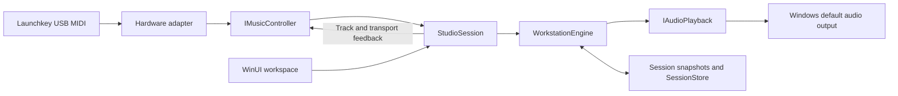

# Architecture

IgnitionSwitch owns sound generation, loop recording, playback, and project storage. No external DAW is required. Its first implementation targets the Launchkey 37 MK3 while keeping the musical model independent of a controller protocol or audio driver.

## Project boundaries

| Project | Responsibility | Dependencies |
| --- | --- | --- |
| `IgnitionSwitch.Core` | Musical snapshots, synthesis, sequencing, validation, and project persistence | .NET libraries only; no external packages |
| `IgnitionSwitch.Midi` | Hardware-neutral controller contracts, Windows MIDI ports, and the verified MK3 profile/codec | Windows MIDI APIs; references no UI or audio engine |
| `IgnitionSwitch.App` | WinUI workspace, session coordination, controller composition, and Windows audio playback | Core, Midi, Windows App SDK, NAudio WASAPI |

`Core/Domain` contains namesake records and the instrument enum. `Core/Audio` synthesizes voices, `Core/Sequencing` owns the engine, and `Core/Persistence` validates and stores snapshots. The public namespaces match those folders.

`Midi/Contracts` defines ordinary performance events, normalized music commands, identity, and feedback. Device-specific identities, port names, channel numbers, mode reports, and packet bytes belong in `Midi/Profiles`, `Midi/Protocol`, and `Midi/Devices`. `StudioSession` consumes commands such as track selection and transport changes. `ControllerFactory` is the application's current choice of adapter; session construction accepts another `IMusicController` without changing the engine.

`LaunchkeyPerformanceRouter` also normalizes verified Drum-layout notes arriving on the control pair into the performance route. It retains pad releases across layout changes, while Session pads remain commands. Ordinary keyboard input bypasses control-output locking. Changing pad layouts invalidates feedback so Drum lighting or Session track colors are repainted immediately.

## Playing and recording

`WorkstationEngine.Render` fills interleaved stereo floating-point samples at 48 kHz. Musical time advances from rendered audio frames. UI refresh timers display that state; they do not drive the sequencer. Scheduled loop events are ordered when recorded content changes. Live playing works while the transport is stopped or paused.

Very short melodic taps retain a smooth 4 ms minimum onset before their release tail, so a note-on followed by note-off between output callbacks cannot cancel an entirely unrendered voice. This does not delay note-on, and explicit panic still clears voices immediately.

Play/pause preserves the transport position. Pausing ends recording, finalizes held recorded durations, and silences sequenced voices and the click while retaining live note/pedal ownership. Resume continues from that position; interrupted loop notes retrigger at their next scheduled onset rather than being reconstructed mid-note. Stop releases everything and rewinds. UI actions and normalized hardware transport commands use the same session behavior.

`LoopEnabled` is a transient playback preference, enabled by default. Disabling repeat finishes the current absolute pass at its next four-bar boundary, ends recording and silences only sequenced/click voices. The terminal position remains at sixteen beats; held live notes and sustain continue. Play or Record from the completed end resets the schedule cursor, click and pending-loop eligibility for a fresh pass without clearing live ownership. Pause preserves the pass target, and changing the repeat preference does not autoplay or change the version 1 project file.

The initial project schema has four instrument tracks and a sixteen-beat loop. Recording uses a quarter-beat (sixteenth-note) grid by default. The transient recording preference can preserve raw sample-clock timing instead; each held note retains its note-on policy. Overdubbing the same pitch at the same onset replaces that recorded note. Duration can cross the loop boundary. Track mutes/gains and master gain affect the shared mix, which is limited before output.

Quantise explicitly corrects the selected track's onsets while preserving durations. Midpoints move forward, the loop end wraps to zero, and the last stored note wins a same-pitch collision. It finalizes recording and commits one bounded history step, preserving live ownership and pending-loop eligibility. An already aligned track adds no phantom content edit. Hardware and UI use the same guarded session command; the recording preference does not change the version 1 project schema.

Retrospective Capture has a separate monotonic rendered-frame/performance-beat clock that advances while project transport is stopped, paused or completed. Only explicit live input enters its bounded ring; sequenced playback does not. The ring retains at most 8,192 completed notes plus 512 held gates, including sustain and actual drum-pad gates. A phrase begins at its first note, after sixteen beats of silence, or at the first new note following a transport discontinuity; carried held gates join the new phrase. Idle time keeps the most recently completed phrase available. Project-playing phrases keep project beat alignment, while stopped phrases begin at zero; the latest four bars retain rests and clip crossing gates.

Capture preflights the complete all-track merge before changing content, voices, schedule or history. Latest note-on order wins a capture collision; unrelated recorded notes stay in place. Capacity failure or relevant ring loss has an explicit result and leaves project content untouched. A successful action forms one bounded history step and one schedule rebuild; unchanged content adds neither. Recording and live ownership continue through capture. Reusable scratch storage avoids allocating a full workspace on each press and is cleared on all return paths and project replacement. The App explicitly excludes input received without a running audio clock, while valid older performance remains recoverable after an output outage. Only resulting loop notes are saved in the version 1 project schema.

The engine serializes input, rendering, and state changes. Rendering releases its lock every 64 frames so input does not wait for a whole output callback. Recorded edits update their scheduled event pair in a preallocated sorted list rather than rebuilding the project schedule. Bounds on voices, recorded events, tempo, and file size keep the initial workload explicit. These are implementation limits, not latency guarantees; a physical audio timing pass remains required.

`AudioPlayback` implements `IAudioPlayback` using event-driven NAudio WASAPI shared-mode output on the Windows default playback device. It requests the shared default device period, with a 30 ms compatibility fallback. Reported playback failures trigger recovery; invalidated devices retry the preferred period. `EngineSampleProvider` adapts the same engine used by tests to the audio callback. A valid output device is needed for audible playback and recording transport.

## Workspace presentation

The WinUI workspace centers transport, track controls, a four-lane loop view, and drum pads. `WorkspaceLayout` keeps measurement finite and sizes the workspace to its viewport. Visible, focusable `ResizeHandle` controls adjust track width and the loop/drum split; minimum sizes prevent collapse, and pane proportions follow native window resizing. Native window minimums are 960 × 600 DIPs, capped to the work area and recalculated when DPI changes. Horizontal scrolling is disabled. Short windows can scroll vertically to retain usable controls.

`LoopTimeline` retains its beat/bar grid and note geometry, updating only changed notes when `NoteRevision` changes. Selection and mixer updates reuse existing visuals. A 16 ms UI timer moves the playhead and consumes coalesced gain-change notifications; other display state refreshes at most every 100 ms. These timers never schedule sound or gate MIDI input. `InstrumentControls` constructs the track and drum controls and reuses palette brushes. Hardware keys provide melodic performance. Device/audio details and shortcut help appear in flyouts when requested, keeping explanatory text outside the main working area.

`SliderMotion` provides shared 100 ms cubic easing for the four track gains and master gain. The native slider value and audio gain reach their targets immediately. Only the displayed thumb position and fill ease toward the latest value through Composition, keeping animation frames out of input and saved-state handling. Unchanged targets do not restart animations. Direct manipulation and resizing settle the visual motion, and the Windows animation preference is respected. Normalized controller gain events only set a coalescing flag on the input thread; the UI reads the latest mixer state on its next timer tick.

Space invokes play/pause, R toggles recording, and Esc stops/rewinds. The stop shortcut remains available while a numeric control has focus. File pickers and confirmations stop recording and block project commands, while live notes, releases, pitch and sustain continue through the performance route.

## Session ownership and persistence

`StudioSession` remembers the track that owns each incoming performance note, so changing selection does not send its release to another instrument. Per-track/pitch owner counts keep overlapping MIDI channels independent: the final owner releases the sound. The conventional MIDI drum channel routes independently to the drum track. Sustain follows held/newly selected melodic tracks and releases all affected tracks on pedal-up. Supported controller actions are normalized before reaching this coordinator. Applying a project resets engine and coordinator note/pedal ownership under the same input lock.

Live input and on-screen pads share the session's note entry points and performance-activity notifications. `PadActivityMailbox` retains an onset sequence, velocity and final held state per MIDI note, so a press/release entirely between UI frames still flashes once. The UI consumes these states on its existing 16 ms tick; native button semantics, hit holds and compositor fades belong to disposable pad presenters. The controller supplies immutable note order and columns, keeping the Launchkey's physical matrix out of the generic presentation code.

Hardware hit feedback is queued without MIDI output on the input thread. A separate worker coalesces changes, serializes sends, keeps short hits visible and restores the current base color. Mapping and activity synchronization never hold the output lock while processing notes. Idle and unchanged held feedback do not continuously wake a worker.

Core history stores bounded note deltas and scalar changes rather than project copies on each input. Recording parts seal at transport/recording boundaries or an actual mixer/clear edit. Scalar gestures coalesce until explicit completion, a different edit or 500 ms idle. Undo and Redo end recording and preserve beat/live ownership. Note edits remove only affected sequenced voices, then rebuild and align the schedule once for the batch; scalar history does not rebuild it. Quantise uses the same batching policy to avoid repeated schedule shifts under the engine lock. Loading a project clears history; the JSON schema stays unchanged.

The session maintains a content revision and a saved revision. `CaptureForSave` uses the engine's atomic, idempotent `EndRecording()` before returning a snapshot with its revision; natural completion cannot turn that save boundary into a recording restart. A completed write marks only the captured revision saved. Changes after capture remain unsaved. Modal file and confirmation operations stop/finalize recording and block project mutations while allowing live auditioning without changing recorded content.

`SessionStore` shares its validation with `ApplySession` and `SaveAsync`. Projects are versioned JSON, limited to 4 MiB, and checked for supported track/loop counts, finite gains and tempo, bounded names, and valid MIDI events. Loading clones collections before applying them. Saving writes a temporary file beside the target, flushes it, then replaces the target.

Saved state includes tempo, loop size, master gain, track names/instruments/mutes/gains, and completed note events. Selection, the metronome toggle, and pitch/sustain automation are not persisted. Sustained notes are stored with their finalized durations.

Controller, audio, and engine lifecycles have separate owners. Session shutdown detaches controller handlers, ignores callbacks captured before disposal, closes hardware/audio resources, and then disposes the engine. Hardware feedback writes are serialized separately from input processing.

## Tests and tooling

All three check projects are dependency-free executable runners:

| Check project | Scope |
| --- | --- |
| `IgnitionSwitch.Core.Tests` | Actual rendered sample data, transport timing and pause/resume, note ownership/release, recording, loop boundaries, project validation, and atomic/cancelled saves |
| `IgnitionSwitch.Midi.Tests` | Pure input decoding, identity/feedback fixtures, port pairing, and mode-aware command mapping; opens no hardware ports |
| `IgnitionSwitch.App.Tests` | Production `StudioSession` compiled through source links with fake controller/audio adapters; UI/hardware transport equivalence, pause ownership/sustain/revisions, modal isolation, feedback, and shutdown |

The App checks link the coordinator and contracts instead of copying its implementation. They reuse the Core check helper. This exercises the real boundary logic without launching WinUI or requiring an audio device.

`IgnitionSwitch.slnx` groups source, checks, and documentation for Visual Studio. Shared build properties enable nullable references, current recommended analyzers, build-time style checks, XML documentation, and warnings as errors. `scripts/verify.ps1` also checks informational diagnostics and pinned prettyCSharp output. Python tooling is hash-pinned in `requirements-dev.txt`; NuGet packages use exact versions and lock files.

## Extending the foundation

Another controller should implement the existing contracts, provide a verified identity/profile and command mapper, and get its own maintained device reference and fixtures. Keep its layout and packet assumptions inside its adapter.

Additional instruments belong in the synthesis/domain layer. Expanding track count, loop length, or saved automation needs an explicit project-schema evolution and corresponding bounds, tests, and coverage updates. VST hosting, sample/audio tracks, effects, export, an arranger, expression synthesis, and external clock synchronization are not present yet.

See the [engine API coverage inventory](in_memory_engine/music_api_coverage.md) and [Launchkey implementation reference](devices/novation_launchkey_mk3_37.md) for current behavior and evidence.
