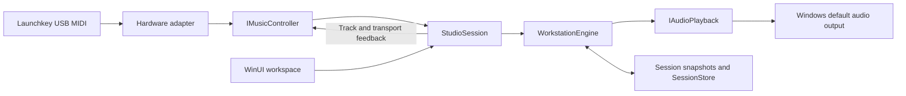

# Architecture

IgnitionSwitch owns sound generation, loop recording, playback, and project storage. No external DAW is required. Its first implementation targets the Launchkey 37 MK3 while keeping the musical model independent of a controller protocol or audio driver.

## Project boundaries

| Project | Responsibility | Dependencies |
| --- | --- | --- |
| `IgnitionSwitch.Core` | Musical snapshots, synthesis, sequencing, validation, and project persistence | .NET libraries only; no external packages |
| `IgnitionSwitch.Midi` | Hardware-neutral controller contracts, Windows MIDI ports, and the verified MK3 profile/codec | Windows MIDI APIs; references no UI or audio engine |
| `IgnitionSwitch.App` | WinUI workspace, session coordination, controller composition, and Windows audio playback | Core, Midi, Windows App SDK, NAudio WASAPI |

`Core/Domain` contains namesake records and the instrument enum. `Core/Audio` synthesizes voices, `Core/Sequencing` owns the engine, and `Core/Persistence` validates and stores snapshots. The public namespaces match those folders.

`Midi/Contracts` defines ordinary performance events, normalized music commands, identity, and feedback. Device-specific identities, port names, channel numbers, mode reports, and packet bytes belong in `Midi/Profiles`, `Midi/Protocol`, and `Midi/Devices`. `StudioSession` consumes commands such as track selection and transport changes. `ControllerFactory` is the application's current choice of adapter; session construction accepts another `IMusicController` without changing the engine.

`LaunchkeyPerformanceRouter` also normalizes verified Drum-layout notes arriving on the control pair into the performance route. It retains pad releases across layout changes, while Session pads remain commands. Ordinary keyboard input bypasses control-output locking. Changing pad layouts invalidates feedback so Drum lighting or Session track colors are repainted immediately.

## Scene and clip model

A new project has one real scene. Up to eight ordered rows use stable slot IDs 0–7; a freed slot can be reused. Each scene contains one sixteen-beat clip for each of four tracks. A track owns its instrument and mixer targets across every scene; scenes contain row metadata and clip content. Notes are stored exactly once in their owning clip. The project allows 2,048 notes per clip and 8,192 notes across all scenes. The legacy constant `MaximumNotesPerTrack` names the per-clip limit.

`EditingSceneId` selects editing/Capture destinations independently of the audible mix. Each track has its own active clip, queued action and local origin. `GetClipNotes(ClipAddress)` returns one detached read-only note list, while `GetClipState` reports its count. `TrackState.NoteCount` describes the editing clip. `CopyTrackPlaybackStates` fills four value-type states under one lock without allocation; `LaunchRevision` identifies transient state changes. `NoteRevision` covers note and scene metadata/structure changes, independently of mixer targets.

Clip event schedules are prepared when content changes. Four bounded pending-action slots hold next-bar launches/stops; a scene command writes all four for one boundary, and a later per-track command replaces only that slot. A launch restarts its clip at local zero. A stopped explicit clip launch starts only that lane and the clock; a stopped scene launch starts its row. Paused queues wait for resumed transport. Switching the editing row does not launch it. Empty unarmed launches stop their lanes; while recording, an empty launch activates a recording destination.

At a launch boundary, the engine batches affected recording finalization and schedule alignment once. Old sequenced voices fade over 5 ms; live notes, pedal ownership, unrelated lanes and already-fed shared effect tails continue. Note eligibility includes the launch generation, so deferred recorded notes do not suppress the first pass of a relaunched clip. No project load or project snapshot swap is used for launching.

Scene create/duplicate/rename/delete and exact-address clear are content edits with bounded chronological Undo. Duplication preflights the combined note budget, deletion preserves at least one scene, and Undo restores content and order without resurrecting old launch queues. Editing/active choices, queues, origins and solo are transient. Their changes alone do not dirty a project; notes finalized during a recording handoff remain ordinary persistent edits.

## Playing and recording

`WorkstationEngine.Render` fills interleaved stereo floating-point samples at 48 kHz. Musical time advances from rendered audio frames. UI refresh timers display that state; they do not drive the sequencer. Scheduled loop events are ordered when recorded content changes. Live playing works while the transport is stopped or paused.

Very short melodic taps retain a smooth 4 ms minimum onset before their release tail, so a note-on followed by note-off between output callbacks cannot cancel an entirely unrendered voice. This does not delay note-on, and explicit panic still clears voices immediately.

Play from stopped launches the editing row at zero; play/pause preserves an existing mix and its transport position. Pausing ends recording, finalizes held recorded durations, and silences sequenced voices and the click while retaining live note/pedal ownership. Resume continues from that position; interrupted loop notes retrigger at their next scheduled onset rather than being reconstructed mid-note. Stop clears voices and queues and rewinds. UI actions and normalized hardware transport commands use the same session behavior.

`LoopEnabled` is a transient playback preference, enabled by default. Disabling repeat finishes the current absolute pass at its next four-bar boundary, ends recording and silences only sequenced/click voices. The terminal position remains at sixteen beats; held live notes and sustain continue. Play or Record from the completed end resets the schedule cursor, click and pending-loop eligibility for a fresh pass without clearing live ownership. Clip launches do not extend this global pass target; natural completion cancels remaining queues and retains sixteen on aligned lane endpoints. Pause preserves the pass target, and changing the repeat preference does not autoplay or change the project file.

All clips have four bars and sixteen beats; tracks share tempo and the global transport clock. Recording uses a quarter-beat (sixteenth-note) grid by default. The transient recording preference can preserve raw sample-clock timing instead; each held note retains its note-on policy. Overdubbing the same pitch at the same onset replaces that recorded note. Duration can cross the loop boundary. Track mutes/gains and master gain affect the shared mix, which is limited before output. Record from stopped starts the editing row. When Record switches on during playback, existing active clips keep their phases and stopped lanes arm into the editing row at local zero. A subsequent explicit lane stop stays unrecorded until another launch or recording rearm. Held notes already being recorded split into old/new clip segments at launches; keys held before Record began stay live-only.

Quantise explicitly corrects the selected track clip's onsets in the editing scene while preserving durations. Midpoints move forward, the loop end wraps to zero, and the last stored note wins a same-pitch collision. It finalizes recording and commits one bounded history step, preserving live ownership and pending-loop eligibility. An already aligned track adds no phantom content edit. Hardware and UI use the same guarded session command; the recording preference does not change the project schema.

Retrospective Capture has a separate monotonic rendered-frame/performance-beat clock that advances while project transport is stopped, paused or completed. Only explicit live input enters its bounded ring; sequenced playback does not. The ring retains at most 8,192 completed notes plus 512 held gates, including sustain and actual drum-pad gates. A phrase begins at its first note, after sixteen beats of silence, or at the first new note following a transport discontinuity; carried held gates join the new phrase. Idle time keeps the most recently completed phrase available. Project-playing phrases keep project beat alignment, while stopped phrases begin at zero; the latest four bars retain rests and clip crossing gates.

Capture preflights the complete all-track merge before changing content, voices, schedule or history. Latest note-on order wins a capture collision; unrelated recorded notes stay in place. Capacity failure or relevant ring loss has an explicit result and leaves project content untouched. A successful action forms one bounded history step and one schedule rebuild; unchanged content adds neither. Recording and live ownership continue through capture. Reusable scratch storage avoids allocating a full workspace on each press and is cleared on all return paths and project replacement. The App explicitly excludes input received without a running audio clock, while valid older performance remains recoverable after an output outage. Only resulting clip notes are saved in the project schema.

Capture merges into the editing row across all original tracks. The shared performance window preserves the phrase's rests and gate durations. For an active destination clip, its local origin is added to the frozen project/performance offset, keeping captured notes aligned with existing playback, including paused held-gate epochs. Inactive/new-row destinations use the common project/free-phrase anchor. Capture against a mix whose clips have different origins preserves that audible mix; later launching the whole row resets every local origin and can change its relative groove. No saved phase-offset feature is implied.

The engine serializes input, rendering, and state changes. Rendering releases its lock every 64 frames so input does not wait for a whole output callback. Individual recorded edits update their clip's sorted event pair; bulk content edits and simultaneous recording handoffs rebuild/align the prepared schedules once. Bounds on voices, recorded events, tempo, and file size keep the initial workload explicit. These are implementation limits, not latency guarantees; a physical audio timing pass remains required.

`AudioPlayback` implements `IAudioPlayback` using event-driven NAudio WASAPI output on the Windows default playback device. Shared is the default and requests the shared default device period, with a 30 ms compatibility fallback. An explicit Devices preference can instead request the driver's minimum exclusive period. That path validates native 48 kHz stereo float or direct PCM16 conversion and rejects NAudio format substitution before playback, avoiding its resampler path. A failed exclusive attempt disposes the candidate and uses shared output; runtime errors also select a shared retry, while device invalidation permits a fresh preferred attempt. The mode is a current-run preference. A valid output device is needed for audible playback and recording transport.

`WasapiOutput` keeps MMCSS registration on the audio worker: its first provider read registers once as Pro Audio, and the worker's completion callback reverts that registration on the same thread. Consumer completion notifications are posted asynchronously after cleanup, avoiding NAudio error-path self-join. The wrapper completion gate remains active through Stop/Join even when the session detaches its own handler. Startup format validation and thread registration do not add work to each note-on.

Synthesis applies per-voice Tone and Drive before summing by track and live/sequenced source. Attack is captured on note-on; release/drum-tail targets affect the rendered tail. Each track feeds a stereo pan law with unity gain at center, then post-fader/mute/pan delay and room sends. The parallel effects use preallocated delay lines, damped feedback/diffusion, target-derived coefficients and crossfaded time/predelay taps. Separate live/sequenced effect lanes let Pause and natural completion clear only sequenced tails. Stop/panic/project replacement reset both lanes logically in constant time. Muting a track blocks new dry/send feeds while already-fed shared tails may spill; muting an effect return preserves its evolving tail. The existing master limiter bounds the final stereo output. Rendering retains 64-frame critical sections and allocates no effect buffers per callback. Warm fixed-voice rendering and bulk playback-state reads measured zero allocation. Scheduled voice starts and finalized recording/history events still allocate, so this does not promise zero allocation at every musical event boundary.

## Live expression

`BeginLiveNote(track, note, velocity, retainForCapture = true, modulation = 0, pressure = 0)` returns an opaque engine-scoped `LiveNoteHandle`. Initial expression and note-on apply under one engine lock. Existing void note methods use the same body with neutral expression. Velocity zero follows the existing release path and returns default. `SetLiveExpression(handle, modulation, pressure)` accepts finite normalized values, returns false for an ineligible gate and never creates or resurrects a voice. Handle `IsValid` means an identity was issued; current liveness is checked by the setter.

Expression follows the current live gate through sustain, Pause, clip launches and Undo. Retriggering its track/pitch invalidates the former handle; real release, Core drum note-off, natural finish, voice stealing, panic, Stop and project replacement end eligibility. Released tails may finish but cannot accept new expression. The existing shared track/pitch final-owner release counts and global pedal behavior remain unchanged. This does not introduce independent same-pitch voices for MIDI channels or MPE.

Wheel modulation adds melodic live vibrato at 5.5 Hz, reaching ±30 cents at full amount. A common free-running carrier advances with rendered frames, including stopped/paused live playing, and is calculated only while needed. Each voice has its own amount. Drum pitch ignores this modulation. Pressure affects live instruments, including drums: effective Tone increases by half its remaining headroom times pressure, and the envelope receives a gain factor of `1 + 0.15 * pressure`. Saved Tone/Level targets and sequenced voices remain unchanged.

Both amounts use 5 ms ramps with an exact zero bypass. Note-on starts immediately while expression values ramp. `LinearRamp` supplies shared value-type arithmetic for the existing `SmoothedValue` wrappers and two inline per-voice controls. The 64-voice bound remains; no heap ramp objects or unbounded expression-owner history are allocated per note. Voice construction and recording/history events retain their ordinary allocation costs.

The App keeps 512 latest track/pitch owner slots and 16-channel modulation/pressure caches. Original channel and handle, rather than later track selection, determine updates. Channel owners are pruned before a new strike so stale/finished gates cannot carry cached pressure into it. Channel and poly pressure combine by maximum. New strikes clear prior note pressure, unowned channel pressure is discarded, and sustained melodic entries survive key-up until pedal release. Wheel position stays cached through Stop, modal auditioning, panic and project loading so a non-spring wheel applies to the next strike; disconnect/disposal reset that cache. Pressure and gate ownership reset at lifecycle boundaries. Input and control callbacks are rejected while disconnected, so queued callbacks cannot revive caches or alter project state. On the control port, MIDI forwards positive/zero pressure for retained playable pad ownership; mode changes alone do not create owners. Performance-port input keeps its ordinary route.

Expression is live transient state. Recording and retrospective Capture still retain notes/gate durations only; no wheel/pressure automation, new persistent parameters, schema fields or Undo entries are added. Documented MK3 pad pressure modes and pure routing fixtures are distinct from physical pressure packet/listening verification, which remains pending.

## Workspace presentation

The WinUI workspace centers transport, track controls, a four-lane loop view, and drum pads. `WorkspaceLayout` keeps measurement finite and sizes the workspace to its viewport. Visible, focusable `ResizeHandle` controls adjust track width and the loop/drum split; minimum sizes prevent collapse, and pane proportions follow native window resizing. Native window minimums are 960 × 600 DIPs, capped to the work area and recalculated when DPI changes. Horizontal scrolling is disabled. Short windows can scroll vertically to retain usable controls.

`LoopTimeline` retains its beat/bar grid and note geometry. Clip notes can be refreshed through `GetClipNotes` using editing scene and `NoteRevision`; playback state has a separate allocation-free four-lane copy path. Selection and mixer updates reuse existing visuals. A 16 ms UI timer moves the playhead and consumes coalesced gain-change notifications; other display state refreshes at most every 100 ms. These timers never schedule sound or gate MIDI input. `InstrumentControls` constructs the track and drum controls and reuses palette brushes. Hardware keys provide melodic performance. Device/audio details and shortcut help appear in flyouts when requested, keeping explanatory text outside the main working area.

`SliderMotion` provides shared 100 ms cubic easing for the four track gains, master gain and Sound inspector. Native target values apply immediately; Core dezippering runs separately on the audio clock. Only the displayed thumb position and fill ease through Composition, keeping animation frames out of input and saved-state handling. Unchanged targets do not restart animations. Direct manipulation and resizing settle the visual motion, and the Windows animation preference is respected. Controller parameter events set coalescing flags; the UI reads the latest mixer state on its next timer tick.

The compact Sound flyout owns eight reusable parameter rows and an Instrument/Echo/Room target selector. It allocates no page snapshots while closed, sizes its scrollable bounds to the viewport, and uses native accessible sliders. A gesture captures its exact parameter address; a target change cancels further writes until release. Device Lock retains the actual instrument across track selection, with explicit device navigation moving the lock to the new device.

`ParameterAddress` and cached descriptors separate normalized targets from controller banks, physical ranges and display units. Tone, Attack, Release (drum Tail), Drive, Pan, two sends and Level form the instrument page. Effects have four global controls and four track sends each. Volume retains four track levels plus master/tempo and adds both effect returns. Pan/Send banks expose the four corresponding track controls. `AbsoluteKnobPickup` reacquires by bank and actual address after external edits; Custom modes, reconnection and modal transitions invalidate stale physical positions. Surface-bank context continues through dialogs while project mutation remains blocked. Only actual canonical target changes advance revision.

Space invokes play/pause, R toggles recording, and Esc stops/rewinds. The stop shortcut remains available while a numeric control has focus. File pickers and confirmations stop recording and block project commands, while live notes, releases, pitch and sustain continue through the performance route.

## Session ownership and persistence

`StudioSession` remembers the track that owns each incoming performance note, so changing selection does not send its release to another instrument. Per-track/pitch owner counts keep overlapping MIDI channels independent: the final owner releases the sound. The conventional MIDI drum channel routes independently to the drum track. Sustain follows held/newly selected melodic tracks and releases all affected tracks on pedal-up. Supported controller actions are normalized before reaching this coordinator. Applying a project resets engine and coordinator note/pedal ownership under the same input lock.

The 64-voice allocator prefers replacing a sequenced voice over a live voice and protects the first 4 ms of a live attack from new sequenced onsets. A full pool of fresh live attacks rejects incoming loop voices; more than 64 simultaneous live attacks still replaces the oldest live voice. This avoids a proven dense-loop case where a newly received pad was evicted before its first sample. It does not establish the cause of reported sparse hardware misses.

Collapsed Devices input diagnostics retain a saturating received-drum count and last/minimum/maximum velocity, independent of recording and audio availability. The counter allocates no objects per hit and formats only while the flyout is open. Reset does not touch content, history, notes or ownership. These are input statistics, rather than rendered-hit or latency measurements.

Live input and on-screen pads share the session's note entry points and performance-activity notifications. `PadActivityMailbox` retains an onset sequence, velocity and final held state per MIDI note, so a press/release entirely between UI frames still flashes once. The UI consumes these states on its existing 16 ms tick; native button semantics, hit holds and compositor fades belong to disposable pad presenters. The controller supplies immutable note order and columns, keeping the Launchkey's physical matrix out of the generic presentation code.

Hardware hit feedback is queued without MIDI output on the input thread. A separate worker coalesces changes, serializes sends, keeps short hits visible and restores the current base color. Mapping and activity synchronization never hold the output lock while processing notes. Idle and unchanged held feedback do not continuously wake a worker.

Core history retains at most 64 steps and 32,768 note deltas, including notes retained by structural scene edits. Note changes carry track/scene addresses and stable IDs; scalar changes use parameter addresses. Input never requires a whole-project history copy. Recording parts seal at transport/recording boundaries or an actual parameter/clear edit. Scalar gestures coalesce by exact parameter address until explicit completion, a different edit or 500 ms idle. Undo and Redo end recording and preserve beat/live ownership. Note edits remove only affected sequenced voices, then rebuild and align the schedule once for the batch; scalar history does not rebuild it. Quantise uses the same batching policy to avoid repeated schedule shifts under the engine lock. Loading a project clears history; history is not persisted.

The session maintains a content revision and a saved revision. `CaptureForSave` uses the engine's atomic, idempotent `EndRecording()` before returning a snapshot with its revision; natural completion cannot turn that save boundary into a recording restart. A completed write marks only the captured revision saved. Changes after capture remain unsaved. Modal file and confirmation operations stop/finalize recording and block project mutations while allowing live auditioning without changing recorded content.

`SessionStore` shares its validation with `ApplySession` and `SaveAsync`. Projects are versioned JSON, limited to 4 MiB, and checked for supported track/loop counts, finite gains and tempo, bounded names, and valid MIDI events. Loading clones collections before applying them. Saving writes a temporary file beside the target, flushes it, then replaces the target.

Schema 3 saves ordered scene metadata, uniquely owned clip notes, tempo, loop size, master gain, shared track names/instruments/mutes/gains and normalized sound/effect targets. Strict version 1 and 2 documents migrate all notes into scene 0; version 1 receives native envelope defaults, centered pan and zero sends. Saves write version 3 with clips only. Required/null/unknown fields, scene ownership, note budgets and nonfinite/out-of-range values are validated before state replacement. Loading prepares the first scene, clears history and resets solo. Editing scene, active/queued clips, local phase, solo, track/device selection and lock, metronome/repeat/grid preferences, live expression/handles, smoothing, DSP buffers and pitch/sustain automation are not persisted. Sustained notes are saved with their finalized durations.

`TrackSnapshot.Clips` is the canonical musical state. The source-compatible constructor/init `Notes` property projects scene 0 and returns an empty list if it has been deleted; it is excluded from JSON to prevent duplicate note storage. Legacy six-field track and seven-field session deconstruction overloads remain available.

Controller, audio, and engine lifecycles have separate owners. Session shutdown detaches controller handlers, ignores callbacks captured before disposal, closes hardware/audio resources, and then disposes the engine. Hardware feedback writes are serialized separately from input processing.

## Tests and tooling

All three check projects are dependency-free executable runners:

| Check project | Scope |
| --- | --- |
| `IgnitionSwitch.Core.Tests` | Actual samples, transport/clip queues and callback partitions, ownership/release, expression DSP/handles and ramps, recording handoffs, scene history/capacity, Capture alignment, schema migration, and atomic/cancelled saves |
| `IgnitionSwitch.Midi.Tests` | Pure input decoding, identity/feedback fixtures, port pairing, and mode-aware command mapping; opens no hardware ports |
| `IgnitionSwitch.App.Tests` | Production `StudioSession` compiled through source links with fake controller/audio adapters; UI/hardware transport equivalence, pause ownership/sustain/revisions, modal isolation, feedback, and shutdown |

The App checks link the coordinator and contracts instead of copying its implementation. They reuse the Core check helper. This exercises the real boundary logic without launching WinUI or requiring an audio device.

`IgnitionSwitch.slnx` groups source, checks, and documentation for Visual Studio. Shared build properties enable nullable references, current recommended analyzers, build-time style checks, XML documentation, and warnings as errors. `scripts/verify.ps1` also checks informational diagnostics and pinned prettyCSharp output. Python tooling is hash-pinned in `requirements-dev.txt`; NuGet packages use exact versions and lock files.

The expression milestone passed all **87 groups**: **41 Core, 28 App and 18 MIDI**. Full `scripts/verify.ps1` validation passed locked restore, the WinUI Release/x64 build, prettyCSharp and informational style/analyzer checks. Local evidence is `artifacts/expression-verification.log`, with output under `artifacts/expression-preview`; that output's Core XML inventory is 205 entries. The four Core `ExpressionTests` groups cover neutral/validation behavior, measured musical response, opaque ownership/lifecycle and callback/allocation behavior. App `ExpressionCommandTests.OwnershipAndAudio`, `.LifecycleAndGuards` and `.HotPath` cover original/latest gate ownership, sustain/cache lifecycle, pressure pruning, disconnected callbacks and the coordinator path. Physical expression controls and integrated visual/listening checks remain separate work.

In the earlier scene build, the ignored `artifacts/scene-benchmark/Program.cs` harness measured offline CPU/allocation only. After 1,024 warm callbacks per case, its second pass measured 0.03557/0.22379/0.97006 ms per 10 ms of audio at 1/16/64 held voices, all with zero allocations. A full 8,192-note scene boundary averaged 0.1379 ms without held recording and 1.9366 ms with 384 held replacements; observed maxima were 0.1682/8.703 ms and allocations were 57,344/122,216 bytes respectively. These historical event costs include scheduled voices and finalized note/history data and predate the inline expression fields. They establish neither a callback deadline nor physical key-to-sound latency.

The ignored `artifacts/expression-benchmark` harness compared held/released audio against the frozen Scenes DLL with zero maximum sample difference at 1/16/64 voices. On .NET 10.0.13 after 1,024 warm callbacks, neutral rendering averaged 0.04629/0.25555/1.02705 ms per 10 ms audio; full wheel/pressure averaged 0.05290/0.28071/1.16687 ms. All six fixed-voice cases were finite and allocated zero bytes. An identically warmed batch of 64,000 expression updates took 2.5034 ms total with zero allocation. These offline observations exclude new voices and history events and establish no physical latency or callback deadline.

The coordinator's hot-path regression warms three identical batches of reused wheel/channel/poly-pressure messages, then measures 60,000 more messages. That batch allocated zero bytes, produced no performance activity, hardware feedback or drum-diagnostic updates, and preserved project content, revision and history. Parsing, message construction, rendering and assertions are excluded from this allocation check; it is not an end-to-end input-latency measurement.

## Extending the foundation

Another controller should implement the existing contracts, provide a verified identity/profile and command mapper, and get its own maintained device reference and fixtures. Keep its layout and packet assumptions inside its adapter.

Additional instruments belong in the synthesis/domain layer. Expanding track count, loop length, or saved automation needs an explicit project-schema evolution and corresponding bounds, tests, and coverage updates. VST hosting, sample/audio tracks, export, an arranger, expression automation, MPE, configurable modulation routing, and external clock synchronization are not present yet.

See the [engine API coverage inventory](in_memory_engine/music_api_coverage.md) and [Launchkey implementation reference](devices/novation_launchkey_mk3_37.md) for current behavior and evidence.
